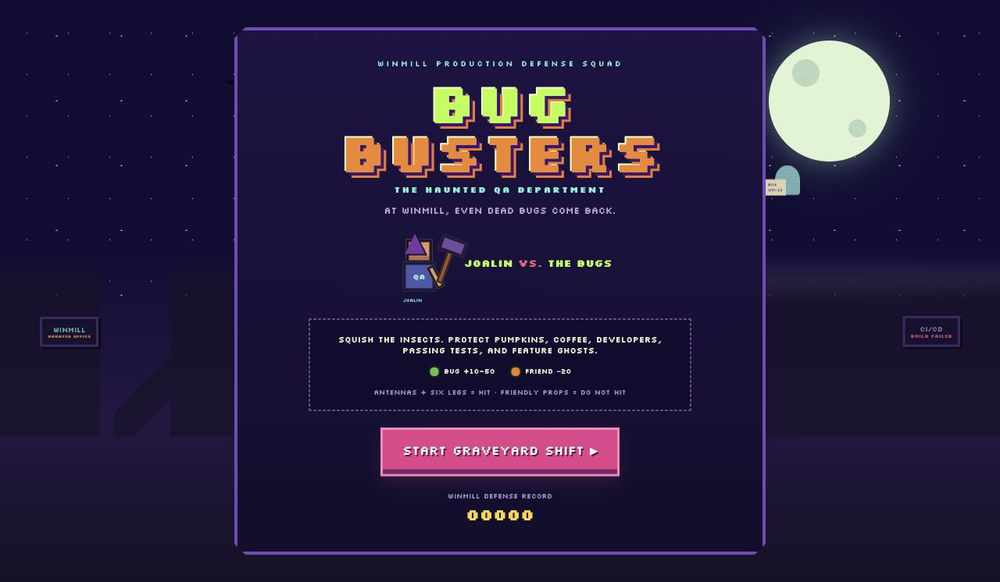
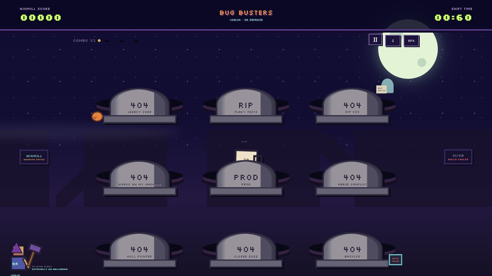
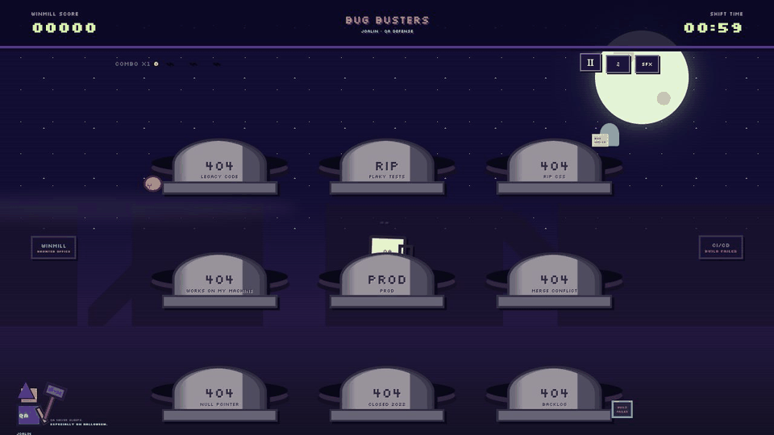

<div align="center">

# 🎃 WINMILL: BUG BUSTERS 👻

### The Haunted QA Department

**A 60-second Halloween arcade game starring Joalin, QA Engineer, and one very determined production-defense mallet.**

*At Winmill, even dead bugs come back.*

### [▶ Play Winmill: Bug Busters](https://joalinpineda.github.io/whack-a-bug/)



</div>

## 🕹️ How to play

1. Select **START GRAVEYARD SHIFT**.
2. **Click or tap the bugs** when they crawl out of the graves.
3. **Do not hit friendly objects** such as pumpkins, QA coffee, developers, passing tests, or feature ghosts.
4. Keep squishing bugs until the **60-second shift** ends.

That is it. Antennas and six legs mean **hit it**; friendly props mean **leave it alone**.



<div align="center">

### See it in action



</div>

## 🪲 Scoring

| Target | Base points | What to do |
|---|---:|---|
| Green bug | +10 | Squish it |
| Flaky purple bug | +15 | Squish it |
| Critical red bug | +25 | Squish it quickly |
| Rare golden bug | +50 | Definitely squish it |
| Friendly object | −20 | Protect it |

Consecutive bug hits build a combo. Every five hits increases the multiplier, up to **4×**. Hitting a friendly object or letting a bug escape resets the combo.

## 🔨 Controls and feedback

- **Mouse:** move over the graveyard and click a target.
- **Touch:** tap a target.
- **Pause:** select `Ⅱ`; select **RESUME DEFENSE** to continue.
- **Music:** use the `♫` button.
- **Sound effects:** use the `SFX` button.

Successful hits trigger the animated QA mallet, a **SQUISH!** effect, sound, and floating points. Friendly hits produce a clear **NOT A BUG!** warning and error sound. Clicking empty ground produces a **THUD!**.

Your audio preferences and best score are saved in the browser on that device.

## 🧪 Run locally

You need a current version of [Node.js](https://nodejs.org/) and npm.

```bash
npm install
npm run dev
```

Open the local address printed by Vite in the terminal.

## ✅ Quality checks

```bash
npm test
npm run build
```

## 🧰 Built with

- React
- TypeScript
- Vite
- Custom CSS pixel art and animation
- Original Web Audio chiptune and sound effects

## 🏆 End-of-shift ranks

| Score | Rank |
|---:|---|
| 0–249 | Junior Bug Hunter |
| 250–549 | QA Engineer |
| 550–899 | Senior Bug Slayer |
| 900+ | Legendary QA Exorcist |

---

<div align="center">

**QA never sleeps. Especially on Halloween.**

</div>
